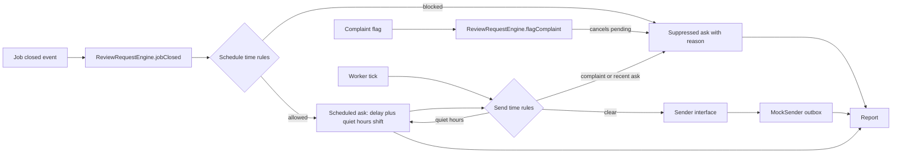

# review-request-engine

Asking for a review at the wrong moment (late at night, right after a complaint, or for the second time this month) costs more goodwill than the review is worth.
This engine turns every closed job into exactly one review ask decision: send it at a sensible time, or suppress it and say why.

## What it does

- Takes a "job closed" event and schedules one review ask after a configurable delay.
- Keeps asks out of quiet hours. An ask that would land at night is moved to the end of quiet hours, in the business's own time zone.
- Never asks after a complaint flag. A complaint on the job blocks the ask, and a complaint raised while an ask is waiting cancels it.
- Never asks the same customer twice inside a window (90 days by default), and never holds two pending asks for one customer.
- Suppresses replayed job events, opted out customers and jobs with no phone number.
- Rechecks the rules at send time, so anything that changed between scheduling and sending still counts.
- Sends through a `Sender` interface. The only sender in this repo is an offline mock that records messages in memory.
- Produces a report of asks sent, suppressed (grouped by reason), failed and still scheduled.

Suppression reasons: `complaint_flag`, `recent_ask_in_window`, `ask_already_pending`, `duplicate_job_event`, `opted_out`, `no_contact`.

## Architecture



| File | Role |
| --- | --- |
| `src/engine.ts` | Rules, scheduling, send loop, event log |
| `src/time.ts` | Quiet hours and time zone math |
| `src/config.ts` | Config from environment variables, with validation |
| `src/sender.ts` | Mock sender |
| `src/report.ts` | Report data and plain text formatting |
| `demo/run.ts` | Offline simulation of one week |

## Run it

Needs Node 22.18 or newer (TypeScript runs directly through Node's built in type stripping, there is no build step).

```
npm install
npm run demo
```

No keys or network access are needed. Configuration is optional; see `.env.example` for the variables and their defaults. The engine reads them through `loadConfig(process.env)`, so export them in your shell or load the file with `node --env-file=.env`.

## Tests

```
npm test
npm run typecheck
```

The tests use Node's built in test runner and cover the delay, quiet hours (including a time zone other than UTC and a daylight saving change), both complaint paths, the dedupe window and its edge, pending duplicates, send failures, the report totals and config validation. CI runs the type check, the tests and the demo on every push.

## Demo

`npm run demo` simulates a week of closed jobs for invented customers with a worker that ticks every 15 minutes. It prints the timeline of inputs, the engine's decision log, the mock outbox and the final report. A captured run is saved in [`demo/output.txt`](demo/output.txt). The summary from that run:

```
Job closed events: 11
Asks sent:         2
Asks suppressed:   7
Sends failed:      1
Still scheduled:   1

Suppressed by reason
  complaint_flag         2
  ask_already_pending    1
  duplicate_job_event    1
  no_contact             1
  opted_out              1
  recent_ask_in_window   1
```

Using it from code:

```ts
import { loadConfig, MockSender, ReviewRequestEngine, buildReport, formatReport } from "./src/index.ts";

const config = loadConfig();
const engine = new ReviewRequestEngine(config, new MockSender());

engine.jobClosed({
  id: "J-1", customerId: "c-1", customerName: "Alex Sample",
  phone: "+1-555-0101", title: "Faucet replacement", closedAt: new Date(),
});
await engine.tick(new Date()); // call on a timer; sends whatever is due
console.log(formatReport(buildReport(engine.asks()), config.timeZone));
```

## Where this pattern runs

This is a clean room version of a pattern drawn from systems that run two small service companies day to day. There, the same shape (one decision per closed job, rules checked at schedule time and again at send time, every suppression recorded with a reason) sits between the job system and the messaging provider. Nothing in this repo comes from those systems: the code is new and all data is synthetic.

## Limitations

- State is in memory. A restart loses scheduled asks, the dedupe history and complaint flags. A real deployment needs a durable store behind the same operations.
- Single process. There is no locking, so two workers ticking against shared state could double send.
- The only sender is the mock. A real provider needs its own `Sender` implementation, plus delivery status handling that this repo does not model.
- A failed send is recorded as failed and not retried.
- A complaint blocks a customer until `clearComplaint` is called. There is no expiry.
- One phone channel, one fixed message template, no per customer time zone. Quiet hours use a single business time zone.
- Quiet hours are a single daily range. There are no weekend or holiday rules.
- The dedupe key is the customer id supplied by the caller. Two ids for the same person are treated as two customers.
- Opt out is read from the job event only. The engine keeps no opt out list of its own and does not process inbound STOP replies.

License: MIT, see the LICENSE file.
