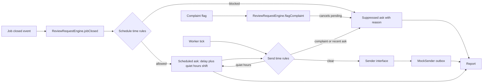

# review-request-engine

For service businesses (plumbers, cleaners, handymen, anyone who closes out jobs) that want more reviews without annoying customers.

Most review requests are sent by hand when someone remembers, or blasted automatically at the wrong moment: late at night, right after a complaint, or twice in one month. Those cost more goodwill than the review is worth.

This engine takes every finished job and makes one decision: ask for a review at a sensible time, or do not ask and record why. The owner gets a report of every ask sent and every ask held back, with the reason.

It is a small TypeScript library with tests and an offline demo. It is the decision logic only: nothing here sends a real text message. See [Limitations](#limitations) for exactly what is mocked.

## What you will see

`npm run demo` replays a week of made up jobs. These lines are copied from the engine log of that run (full capture in [`demo/output.txt`](demo/output.txt), and CI fails if the demo stops matching it):

```
Mon 2026-11-02 10:00  ask-001  scheduled for Mon 2026-11-02 12:00
Mon 2026-11-02 12:00  ask-001  sent to +1-555-0101 (mock-0001)
Mon 2026-11-02 12:10  ask-002  suppressed: complaint_flag (complaint flagged Mon 2026-11-02 12:10)
Mon 2026-11-02 19:15  ask-004  scheduled for Tue 2026-11-03 09:00 (moved out of quiet hours)
Mon 2026-11-02 19:40  ask-005  suppressed: ask_already_pending (ask-004 for job J-104 is already scheduled)
Thu 2026-11-05 15:00  ask-010  suppressed: recent_ask_in_window (ask-001 was sent Mon 2026-11-02 12:00, inside the 90 day window)
```

And the summary at the end of the same run:

```
Job closed events: 11
Asks sent:         2
Asks suppressed:   7
Sends failed:      1
Still scheduled:   1
```

"Sent" here means handed to the mock sender. The one failure is the mock rejecting a number on purpose.

## What it does

- Takes a "job closed" event and schedules one review ask after a configurable delay (2 hours by default).
- Keeps asks out of quiet hours (20:00 to 09:00 by default). An ask that would land at night is moved to the end of quiet hours, in the business's own time zone.
- Never asks after a complaint flag. A complaint on the job blocks the ask, and a complaint raised while an ask is waiting cancels it.
- Never asks the same customer twice inside a window (90 days by default), and never holds two pending asks for one customer.
- Suppresses replayed job events, opted out customers and jobs with no phone number. An opt out also cancels an ask still waiting for that customer.
- Rechecks the complaint, quiet hours and window rules at send time, so anything that changed between scheduling and sending still counts.
- Sends through a `Sender` interface. The only sender in this repo is an offline mock that records messages in memory.
- Produces a report of asks sent, suppressed (grouped by reason), failed and still scheduled.

Suppression reasons: `complaint_flag`, `recent_ask_in_window`, `ask_already_pending`, `duplicate_job_event`, `opted_out`, `no_contact`.

Timing depends on the caller: an ask goes out on the first `tick` at or after its planned time, so a worker that ticks every 15 minutes can send up to 15 minutes late. It never sends early.

## Architecture



| File | Role |
| --- | --- |
| `src/engine.ts` | Rules, scheduling, send loop, event log |
| `src/time.ts` | Quiet hours and time zone math |
| `src/config.ts` | Config from environment variables, with validation |
| `src/sender.ts` | Mock sender |
| `src/report.ts` | Report data and plain text formatting |
| `demo/run.ts` | Offline simulation of one week |

## Run it

Needs Node 22.18 or newer (TypeScript runs directly through Node's built in type stripping, there is no build step). CI runs on Node 22 and 24.

```
npm install
npm run demo
```

No keys or network access are needed. Configuration is optional; see `.env.example` for the variables and their defaults. The engine reads them through `loadConfig(process.env)`, so export them in your shell or load the file with `node --env-file=.env`. The demo uses its own fixed settings and ignores the environment.

## Tests

```
npm test
npm run typecheck
```

22 tests on Node's built in test runner. They cover the delay, quiet hours (a time zone other than UTC and both daylight saving changes), both complaint paths, the dedupe window and its edge, pending duplicates, opt out cancelling a waiting ask, send failures including a sender that throws, overlapping ticks, the report totals and config validation. CI runs the type check, the tests and the demo on every push, and compares the demo output with `demo/output.txt`.

## Demo

`npm run demo` simulates a week of closed jobs for invented customers with a worker that ticks every 15 minutes. It prints the timeline of inputs, the engine's decision log, the mock outbox and the final report. The captured run is in [`demo/output.txt`](demo/output.txt).

Using it from code:

```ts
import { loadConfig, MockSender, ReviewRequestEngine, buildReport, formatReport } from "./src/index.ts";

const config = loadConfig();
const engine = new ReviewRequestEngine(config, new MockSender());

engine.jobClosed({
  id: "J-1", customerId: "c-1", customerName: "Alex Sample",
  phone: "+1-555-0101", title: "Faucet replacement", closedAt: new Date(),
});
await engine.tick(new Date()); // call on a timer; sends whatever is due
console.log(formatReport(buildReport(engine.asks()), config.timeZone));
```

## Where this pattern comes from

This is a clean room version of a pattern drawn from systems that run two small service companies day to day. There, the same shape (one decision per closed job, rules checked at schedule time and again at send time, every suppression recorded with a reason) sits between the job system and the messaging provider. Nothing in this repo comes from those systems: the code is new, all data is synthetic, and this code itself has not been deployed anywhere.

## Limitations

What is mocked or missing:

- No message has ever left this code. The only sender is `MockSender`, which stores messages in memory. It has never been run against an SMS provider, an email service, a job management system or a review site. A real provider needs its own `Sender` implementation, plus delivery status handling that this repo does not model.
- There is no server, webhook receiver or scheduler. The caller feeds in job events and calls `tick` on a timer.
- The engine does not know whether a customer left a review. It reports asks, not reviews, and makes no claim about how many reviews an ask produces.
- The message is one fixed template with no opt out wording. Consent and messaging rules for your region and provider are not handled here.

What the logic does not do:

- State is in memory. A restart loses scheduled asks, the dedupe history and complaint flags. A real deployment needs a durable store behind the same operations.
- Single process. Overlapping ticks inside one engine are guarded, but two processes working from shared state would need locking to avoid a double send.
- A failed send is recorded as failed and not retried.
- A job suppressed as `ask_already_pending` gets no ask of its own later, even if the pending ask then fails or is cancelled.
- A complaint blocks a customer until `clearComplaint` is called. There is no expiry.
- One phone channel, no per customer time zone. Quiet hours use a single business time zone and a single daily range, with no weekend or holiday rules.
- The dedupe key is the customer id supplied by the caller. Two ids for the same person are treated as two customers.
- Opt out is read from the job event only. It cancels a waiting ask, but the engine keeps no opt out list of its own, so a later job event without the flag is treated as contactable. It does not process inbound STOP replies.

License: MIT, see the LICENSE file.
